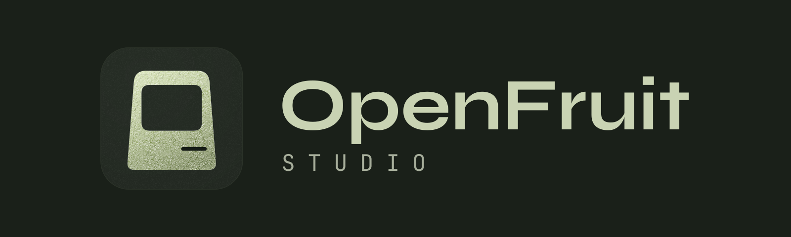

<p align="center">
  
</p>

A desktop IDE for building iOS apps on Windows, powered by [OpenFruit](https://github.com/ssilvestri15/openfruit).

If OpenFruit is the engine, **OpenFruit Studio is the interface that makes it accessible.**

OpenFruit Studio is a desktop IDE for Windows, inspired by development environments such as Android Studio, IntelliJ IDEA and VS Code.

The idea is simple: someone who has never owned a Mac should still have the opportunity to open an iOS project, explore its source code, understand its structure, and learn how to build an application.

### The architecture

OpenFruit Studio is designed around a separation between the development interface and the underlying build engine.

The IDE handles the developer experience: project management, source editing, navigation, SDK configuration, build commands, and diagnostics.

OpenFruit handles the actual compilation pipeline.

This separation allows the build engine to evolve independently of the IDE and potentially be integrated into other development tools.

### What makes it interesting?

- **Accessible development:** A Windows-first environment for exploring and building iOS applications.
- **Familiar experience:** A modern IDE inspired by established professional development tools.
- **Integrated workflow:** Project creation, Git integration, SDK management, source editing, and compilation in one place.
- **Learning-oriented:** Designed to encourage developers to explore code, understand errors, and learn through experimentation.
- **Open ecosystem:** Built around an independent engine rather than a closed development environment.

### What are the limitations?

OpenFruit Studio is still in its early development stages.

The interface, editor integration, debugging tools, and overall developer experience are evolving. Its compilation capabilities also depend on the compatibility and maturity of OpenFruit itself.

Building a good IDE takes much more than creating an attractive interface. It requires reliable language tooling, responsive editing, meaningful diagnostics, debugging capabilities, and a workflow that developers can trust.

That's the long-term challenge.

## Getting started

OpenFruit Studio runs on **Windows 10 or 11 (x64)**. These links point to the latest stable GitHub release once it is published.

- **[Download Windows Setup](https://github.com/ssilvestri15/openfruit-studio/releases/latest/download/OpenFruit-Studio-Setup-x64.exe)** for a guided installation with optional OpenFruit, Git for Windows, Apple Devices, and a desktop shortcut.
- **[Download Windows Portable](https://github.com/ssilvestri15/openfruit-studio/releases/latest/download/OpenFruit-Studio-Portable-x64.exe)** to run Studio directly. Set up any tools you need separately.
- [View release notes and earlier versions](https://github.com/ssilvestri15/openfruit-studio/releases).

### Build your first iOS project

1. Install the [OpenFruit CLI](https://github.com/ssilvestri15/openfruit) and configure an iOS SDK using its instructions. Studio looks for the executable in `OPENFRUIT_BIN`, then `OPENFRUIT_HOME\bin\openfruit.exe`, then `%LOCALAPPDATA%\OPENFRUIT\bin\openfruit.exe`.
2. Launch Studio and choose **Create a new project** with the Xcode SwiftUI template, or **Open an existing project**. Choose **Settings → General → Language** for English or Italian.
3. Choose a scheme or target in **Project settings** if needed, then click **Build**. Follow progress in **Output** and diagnostics in **Problems**. To deploy over USB, configure signing in OpenFruit and connect a paired iPhone. USB deployment requires Apple Devices or iTunes.

Studio is an early preview. Build and deployment support depends on the OpenFruit toolchain and the project’s configuration. The setup and portable include Studio and Electron. Configure the iOS SDK and Apple credentials separately in OpenFruit.

### Build from source

```powershell
git clone https://github.com/ssilvestri15/openfruit-studio.git
cd openfruit-studio
npm ci
npm run build
npm start
```

`npm run dist` creates the Windows installer and the portable executable in `release\`.

The setup window lets you choose the installation folder and scope, create a desktop shortcut and opt in to OpenFruit, Git for Windows and Apple Devices. The window uses WPF through the Windows PowerShell included with Windows. NSIS installs the application in the background and handles uninstallation.

Git and Apple Devices use Windows Package Manager. OpenFruit is downloaded from the latest public stable release of its official repository when that release supplies a single Windows x64 installer named `OpenFruit Setup <version>.exe` (or `OpenFruit Setup.exe`) with a GitHub SHA-256 digest. If an optional component is unavailable, Studio remains installed and the setup reports the issue. Configure iOS SDKs separately through OpenFruit.

### Publish a Windows release

1. Run **Windows build and release** manually from a branch and download the Windows x64 Actions artifact for review.
2. Configure the repository’s Actions secrets `WIN_CSC_LINK` with the base64-encoded production code-signing PFX and `WIN_CSC_KEY_PASSWORD` with its password. Use a certificate trusted by Windows. See the [electron-builder signing guide](https://www.electron.build/docs/features/code-signing/).
3. Push a tag matching the version in `package.json`, for example `v0.1.0`. The workflow runs the test suite and UI smoke test, builds and signs both executables, then runs the packaged smoke test and verifies both timestamped Authenticode signatures. Only then does it publish the assets to GitHub Releases.

Packaged copies of Studio check GitHub Releases for a newer stable version at startup. Publishing a prerelease makes it available on the Releases page while stable download links continue to point to the latest stable release.

## How it talks to OpenFruit

Studio runs the OpenFruit CLI and reads its structured output; it has no build logic of its own.

- **Discovery:** `openfruit capabilities` tells Studio which operations the installed engine supports; `openfruit devices --json` lists connected iPhones.
- **Build:** `openfruit build <project> --diagnostics=json`, plus `--deploy --udid <UDID>` for *Build and install*. Unsaved files are saved first.
- **Telemetry:** JSON Lines events update the Build button (stage and percent, install percent), feed the Problems panel with compiler diagnostics, and report the signed IPA and bundle ID at the end.
- **Live preview:** *Build and start* in the canvas builds with `--preview`, installs the app, and streams it from the iPhone with `openfruit device preview`; Studio decodes the H.264 stream with WebCodecs. The app must be opened on the iPhone; the preview needs a connected device.
- **Cancel** stops the CLI and its child processes.

## License

OpenFruit Studio is licensed under the [MIT License](LICENSE).

## Trademarks and Apple software

**Trademarks.** Apple, the Apple logo, iPhone, iPad, iOS, iPadOS, macOS, Xcode, Swift, SwiftUI, App Store and TestFlight are trademarks of Apple Inc., registered in the U.S. and other countries and regions. All other product and company names mentioned in this repository (including Delta, VLC, Swiftfin, Jellyfin and Nextcloud) are trademarks or registered trademarks of their respective owners. They are used only to identify the corresponding products and the projects tested for compatibility. OpenFruit and OpenFruit Studio are independent projects and are not affiliated with, endorsed, sponsored or approved by Apple Inc. or by any other owner of the trademarks mentioned.

**Apple software.** OpenFruit and OpenFruit Studio do not include or redistribute Xcode, the iOS SDK, Apple's compiler plugins or any other Apple software. Users obtain them with their own Apple account and are solely responsible for complying with the license agreements that govern them (including the Xcode and Apple SDKs Agreement and the Apple Developer Program License Agreement), with Apple's terms for code signing and device installation, and with the licenses of the third-party projects they build.

## Development

```powershell
npm run lint
npm test
npm run test:desktop
```

`test:desktop` needs a build and OpenFruit installed. Detailed development notes (in Italian) are in [docs/DEVELOPMENT.md](docs/DEVELOPMENT.md).

Made with ❤️ by Simone and his friend AI 🤖
