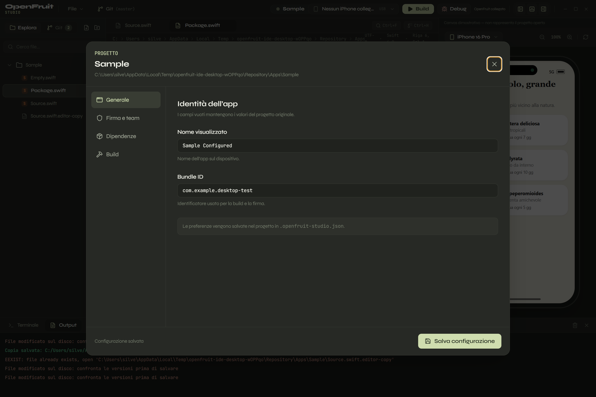

Aggiornamento successivo: per i progetti Xcode vedi il [parser e project editor nativo](XCODE_PROJECT_EDITOR_2026-10-30.md). Il comportamento dei manifesti PBX descritto sotto riguarda lo stato precedente.

# Terminale interattivo, merge e configurazione progetto — 30 ottobre 2026

Il quinto intervento prosegue la review e aggiunge la schermata richiesta cliccando
sul nome dell'app. I sorgenti del repository erano già untracked; non sono stati
creati commit e i test usano progetti temporanei.

## Configurazione progetto

Il nome nella barra superiore e quello della radice nell'albero aprono la stessa
schermata. La freccia della radice continua a espandere e comprimere le cartelle.
La schermata gestisce tastiera, Escape, Ctrl+S, focus e modifiche non salvate.

- **Generale:** nome visualizzato e override del Bundle ID.
- **Firma e team:** Team ID di riferimento, percorso del certificato P12 e del
  provisioning profile. Il team effettivo deriva dagli input di firma del motore;
  il CLI installato non espone un override Team ID e l'IDE non ne inventa uno.
  La password rimane nelle credenziali OpenFruit.
- **Dipendenze:** modifica dei manifesti originali Package.swift, Podfile,
  Cartfile e project.pbxproj dei progetti Xcode immediatamente sotto la cartella
  aperta. Nessuna riscrittura automatica del formato. I salvataggi verificano la
  revisione; in caso di conflitto le modifiche restano nella schermata.
- **Build:** Debug/Release, versione SDK e processi paralleli. I campi vuoti
  mantengono le impostazioni originali del progetto o del motore.

Le preferenze vengono salvate atomicamente in `.openfruit-studio.json`, con
controllo della revisione e serializzazione delle scritture concorrenti. Il
backend applica gli stessi limiti del workspace delle altre operazioni sui file.
La chiusura dell'app attende anche questi salvataggi. Il nome visualizzato non
rinomina cartelle, target o simboli Swift.
I manifesti già aperti nell'editor e privi di modifiche locali vengono aggiornati
dopo il salvataggio nella configurazione; eventuali modifiche locali restano intatte.

La build legge la configurazione dopo aver salvato i tab modificati e passa solo
gli argomenti verificati nell'help del CLI installato: `--configuration`,
`--bundle-id`, `--display-name`, `--p12`, `--provision`, `--sdk-version`, `-j`.
Gli argomenti rimangono separati e non vengono eseguiti da una shell.

## Terminale PTY

La UI usa xterm 6, FitAddon e node-pty 1.1.0, con ConPTY su Windows. Le shell
PowerShell sono interattive: supportano Read-Host, frecce, ANSI, ridimensionamento
e Ctrl+C senza perdere la sessione. Il vecchio endpoint non interattivo resta
compatibile con i test precedenti; il terminale visibile usa le nuove API PTY.

Ogni sessione appartiene a una finestra, ha un token e un ID univoco anche durante
il doppio montaggio di React StrictMode. I terminali restano vivi quando il
pannello viene nascosto o si passa alla scheda Output. Cambiare progetto o chiudere
il tab termina le sessioni corrispondenti. La chiusura dell'app attende l'uscita
delle shell.

Il produttore si ferma oltre 100.000 caratteri non ancora elaborati e riparte
sotto 10.000. La conferma arriva dal callback di `xterm.write`, dopo il parsing.
Scrollback, input e dimensioni sono limitati; una conferma tardiva dopo la chiusura
è ignorata. ResizeObserver pianifica il fit con requestAnimationFrame.

Il test ha rilevato che node-pty 1.1.0 con `useConptyDll` conserva il worker di
output dopo l'uscita naturale della shell. Il rilascio è isolato nel manager e
coperto da un test che confronta le risorse MessagePort prima e dopo. Questo
adattamento usa un dettaglio interno della versione fissata: aggiornando node-pty
vanno rieseguiti i test di lifecycle e del pacchetto.

xterm e configurazione sono caricati separatamente. Il bundle iniziale è circa
318 kB non compressi, contro circa 652 kB quando xterm era incluso staticamente;
non è una misura del tempo di avvio. Rimane l'avviso Vite sul chunk Monaco.

## Merge a tre vie

I tab conservano il testo della versione di base oltre alla revisione. Il comando
**Unisci automaticamente** confronta base, editor e disco tramite
`git merge-file --diff3`, usando copie temporanee e preservando CRLF quando presente
nel contenuto locale. La revisione della base è verificata prima del merge.

Il risultato si apre nel confronto modificabile, senza scrivere il sorgente.
Le modifiche indipendenti vengono combinate; quelle sovrapposte mantengono i
marcatori diff3. Salva, Salva tutti, riconciliazione e build rifiutano un merge
con marcatori ancora presenti. Il flag sopravvive nella sessione dell'editor.
Un secondo cambiamento esterno provoca un nuovo conflitto al salvataggio.
Risultati arrivati dopo nuove modifiche locali o un cambio workspace non vengono
applicati. Le vecchie sessioni prive della base conservano il confronto manuale.

## Verifiche e limiti

- TypeScript, 31 test unitari/integrazione e build Vite/Electron.
- Smoke desktop: click sul nome e sulla radice, validazione, persistenza e
  modifica del manifesto; merge indipendente e sovrapposto dentro Monaco;
  salvataggio protetto; richieste interattive, cronologia, resize, Ctrl+C e
  backpressure su ConPTY reale. Restano verificati i flussi Git e CLI precedenti.
- Pacchetto Windows x64 `electron-builder --win --dir`, caricamento del modulo
  nativo, DLL, worker ed esecuzione di PowerShell dal runtime incluso nel pacchetto.
  Il test confronta anche tutti i file di `dist` e `dist-electron` con quelli
  nell'archivio, per rilevare build cambiate durante il packaging. Build e
  packaging devono avvenire in sequenza; `npm run dist:dir` applica questo ordine.
- `npm audit`: zero vulnerabilità al momento del controllo, risultato in
  `npm-audit-pty-settings-2026-10-30.json`.

Il packaging usa i binari precompilati inclusi in node-pty e li estrae da ASAR;
`node-pty` è esterno al bundle esbuild. `npmRebuild: false` evita una ricompilazione
non necessaria per i prebuild verificati. La ricompilazione locale iniziale
falliva per l'assenza delle librerie Spectre del toolset Visual Studio. Un nuovo
modulo nativo o un'altra piattaforma richiedono una nuova verifica di questo
assetto. Per riprodurre il controllo: `npm run dist:dir`, poi
`npm run test:packaged`.

Non sono stati verificati un installer installato su una macchina pulita, una
build iOS firmata o un deploy. Il test del pacchetto copre il runtime nativo,
non l'intero flusso dell'installer. Restano da affrontare i salvataggi sorgente
transazionali in caso di errore disco, la dimensione del pacchetto, la
scomposizione di App.tsx e la tipizzazione dei vecchi endpoint del bridge.
SDK manager, canvas e debug mantengono i limiti descritti nei report precedenti.

Riferimenti tecnici: [node-pty](https://github.com/microsoft/node-pty),
[flow control xterm](https://xtermjs.org/docs/guides/flowcontrol/),
[git merge-file](https://git-scm.com/docs/git-merge-file).
