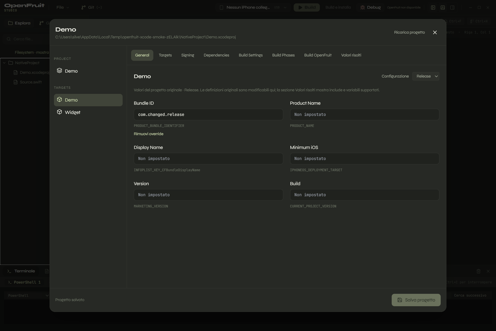

# Progetti Xcode e parsing PBX — 30 ottobre 2026

Il progetto `.xcodeproj` viene rappresentato nel navigatore come un elemento
unico. Il suo `project.pbxproj` non compare come normale file sorgente; cliccando
sul progetto o sul nome dell'app si apre un editor strutturato. È il modello
descritto da Apple per il [Project Editor](https://help.apple.com/xcode/mac/current/en.lproj/devb3575be3e.html).

## Implementato

- Parser OpenStep per il `.pbxproj`: dizionari, array, stringhe quotate e non,
  commenti, escape, Unicode e dati esadecimali. Limiti di dimensione, profondità
  e numero di elementi; errori espliciti per sintassi non valida e chiavi duplicate.
- Lettura di progetto, target e configurazioni effettivamente presenti, senza
  fabbricare Debug/Release o identificatori mancanti. Discovery anche nelle
  sottocartelle autorizzate, escludendo i percorsi ignorati e le junction.
- Selezione separata PROJECT/TARGETS e della configurazione da modificare.
- General: Bundle ID, nome prodotto, display name, versione iOS minima,
  marketing version e build number.
- Signing: `DEVELOPMENT_TEAM`, `CODE_SIGN_STYLE`, `CODE_SIGN_IDENTITY` e
  `PROVISIONING_PROFILE_SPECIFIER`. Il Team ID modifica il progetto originale,
  anziché rimanere un riferimento nella configurazione IDE.
- Build Settings: lettura e modifica dei valori scalari e degli array,
  filtro, aggiunta di chiavi e rimozione degli override. Le impostazioni del
  progetto sono mostrate come ereditate nei target con configurazione omonima.
- Dependencies: riferimenti ai target e ai prodotti Swift Package; Build Phases:
  fasi e relativi file/framework/prodotti. Queste due sezioni sono in sola lettura.
- Rilettura esplicita del progetto e conferma prima di scartare modifiche locali,
  anche durante la chiusura della finestra. Ctrl+S salva il progetto selezionato.

## Scrittura e integrazione

Il parser conserva i range dei valori nel sorgente. Il salvataggio sostituisce
solo i valori richiesti o inserisce/rimuove le singole impostazioni. Non riscrive
l'intero progetto: gli altri target, commenti, ordine, identificatori e oggetti
sconosciuti restano invariati. Gli ID di configurazione modificabili devono
appartenere al progetto o ai suoi target. Il risultato viene nuovamente parsato
prima della scrittura.

La scrittura PBX usa la coda condivisa con i salvataggi dell'editor, verifica la
revisione, scrive e sincronizza un file temporaneo nella stessa cartella, controlla
di nuovo la versione e sostituisce il file con rename. Gli errori e le modifiche
esterne mantengono i valori locali nella schermata. Gli accessi vengono verificati
rispetto al workspace anche durante gli eventuali tentativi di rename su Windows.

Nei progetti Xcode gli override legacy di Bundle ID e display name contenuti in
`.openfruit-studio.json` non vengono passati alla build: l'identità viene letta dal
progetto originale. Il file IDE resta disponibile per i parametri di invocazione
del motore. Per i progetti senza `.xcodeproj` rimane la configurazione precedente.

## Verifica

- TypeScript, build Vite/Electron e 37 test unitari/integrazione.
- Fixture con due target, configurazioni distinte, array, chiavi condizionali,
  riferimenti `.xcconfig`, dipendenze e un oggetto futuro con dati binari.
- Confronto esatto del testo prima/dopo: una modifica al Bundle ID di Debug non
  cambia Release, il secondo target o gli oggetti sconosciuti; CRLF preservato.
- Parsing in sola lettura di cinque ulteriori fixture PBX già presenti nel
  repository locale del motore OpenFruit: nessun errore. Non è una verifica di
  tutti i progetti Xcode possibili.
- `npm run test:xcode`: navigatore senza interni del package, click sul progetto,
  lettura dei valori reali, selezione target/configurazione, salvataggio di Bundle
  ID e team nel file originale, dipendenze e fasi strutturate, conflitto esterno
  senza perdita della bozza e rilettura esplicita. Fixture e stato app temporanei.
- Smoke desktop precedente verificato anche con il nuovo instradamento della
  configurazione, mantenendo i flussi terminale, merge, editor e Git.

## Distanza ancora presente rispetto a Xcode

Questo intervento introduce il modello strutturato e la modifica delle impostazioni;
non rende ancora l'IDE equivalente a Xcode. Mancano:

- navigatore costruito da `PBXGroup` e dai gruppi sincronizzati, target membership
  e riferimenti a sorgenti esterni alla cartella, anziché l'attuale albero fisico;
- gestione completa di workspace, scheme e selezione del target per la build;
- valutazione completa di `.xcconfig`, include, variabili, condizioni SDK e livelli
  di ereditarietà. La UI mostra valori definiti e alcune eredità progetto/target,
  non pretende di essere il risultato risolto del compilatore;
- aggiunta/rimozione di dipendenze, modifica delle build phases, capabilities,
  entitlements e un editor completo delle proprietà Info.plist;
- apertura della configurazione come tab centrale del workbench: attualmente è
  una schermata a dialogo con struttura progetto/target.

La build completa di un'app iOS e l'apertura del progetto salvato in Xcode su macOS
non sono state verificate. L'app già aperta dell'utente non viene riavviata né
sostituita durante i test; il pacchetto Windows generato nel precedente intervento
non è stato rigenerato in questo passaggio.
